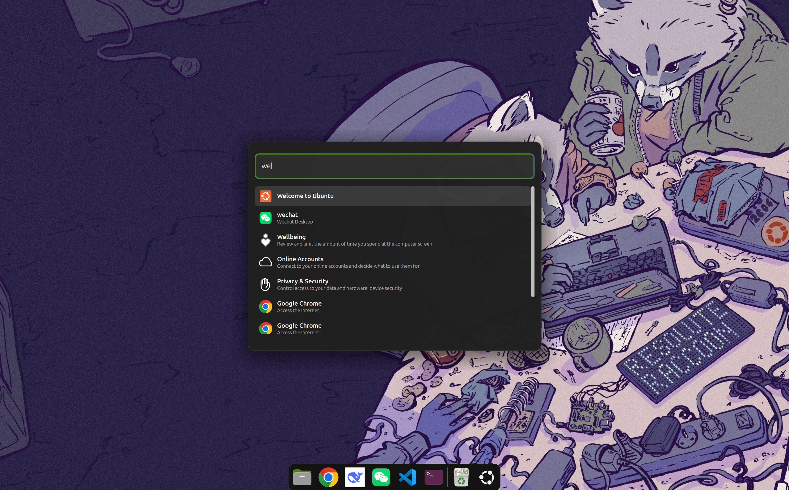

# Pop Launcher Super-Key

### A standalone GNOME Shell 45-50 fork

A standalone, Pop Launcher-style application launcher for GNOME Shell,
opened with the **Super** key.

Repository:
<https://github.com/icesx/gnome-shell-extension-pop-launcher-super-key>



## About this fork

This repository is a modified fork of
[ManeLippert/gnome-shell-extension-pop-launcher-super-key](https://github.com/ManeLippert/gnome-shell-extension-pop-launcher-super-key).
The fork is based on the original extension's version 12.
That extension was itself inspired by System76's
[Pop Shell](https://github.com/pop-os/shell) and
[Pop COSMIC](https://github.com/pop-os/cosmic) launcher.

The original extension delegated the Super key to Pop Shell's internal
launcher window. This fork replaces that integration with a launcher UI
implemented directly in the extension, so **Pop Shell and the external
pop-launcher service are no longer required**.

This is an independent community fork and is not affiliated with System76
or the original extension author.

## Features

- Open and close the launcher with **Super**
- Search installed applications as you type
- Select results with **Up** and **Down**
- Launch with **Enter**
- Launch the first nine results with **Ctrl+1** through **Ctrl+9**
- Close with **Esc**, a second **Super** press, or a click outside the dialog
- Respects GNOME's sticky-keys accessibility setting
- Lightweight, self-contained UI with Pop Launcher-inspired styling

## Requirements

- GNOME Shell **45 through 50**
- No additional GNOME extensions
- No Pop Shell installation
- No separate pop-launcher service

Tested on GNOME Shell **50.1**.

## Installation

### Quick install from a release zip

```bash
cd ~/Downloads
gnome-extensions install --force pop-launcher-super-key@icesx.zip
```

If the archive is somewhere else, replace the path with its full path.
This installs the extension for the current user and does not require
`sudo`.

GNOME Shell only scans new extension directories during startup, so log out
and log back in now.

On X11, restarting the shell with **Alt+F2**, `r`, **Enter** is also
possible. Wayland sessions require a new login.

After logging in again, enable the extension:

```bash
gnome-extensions enable pop-launcher-super-key@icesx
```

Verify that it is active:

```bash
gnome-extensions info pop-launcher-super-key@icesx
```

The output should contain:

```text
State: ACTIVE
```

Then press **Super**.

> If `gnome-extensions enable` says the extension does not exist
> immediately after installation, that is expected. Log out and back in
> first, then run the command again.

### Enable through the GUI

After logging back in, open **Extensions** (or **Extension Manager**) and
enable **Pop Launcher Super-Key**.

You can also check the enabled list from a terminal:

```bash
gnome-extensions list --enabled
```

### Install from source

On Ubuntu or Debian, install the build tools first:

```bash
sudo apt update
sudo apt install git make libglib2.0-bin zip
```

On other distributions, install the equivalent packages. The
`glib-compile-schemas` command must be available.

Clone the repository and install:

```bash
git clone https://github.com/icesx/gnome-shell-extension-pop-launcher-super-key.git
cd gnome-shell-extension-pop-launcher-super-key
make
make install
```

`make install` installs the extension to:

```text
~/.local/share/gnome-shell/extensions/pop-launcher-super-key@icesx/
```

Log out and back in, then enable it if necessary:

```bash
gnome-extensions enable pop-launcher-super-key@icesx
```

### Build the release archive yourself

```bash
make zip-file
```

The resulting archive is:

```text
pop-launcher-super-key@icesx.zip
```

### Uninstall

Disable and remove the extension with:

```bash
gnome-extensions disable pop-launcher-super-key@icesx
gnome-extensions uninstall pop-launcher-super-key@icesx
```

Or remove the user extension directory:

```bash
rm -rf ~/.local/share/gnome-shell/extensions/pop-launcher-super-key@icesx
```

Log out and back in after removing it.

## Usage

Press **Super** to open the launcher. Start typing an application name and
press **Enter** to launch the selected result.

| Key | Action |
| --- | --- |
| `Super` | Open the launcher, or close it when already open |
| `Up` / `Down` | Move the selection |
| `Enter` | Launch the selected application |
| `Ctrl+1` ... `Ctrl+9` | Launch a result directly |
| `Esc` | Close the launcher |

Clicking outside the dialog also closes it.

## Changes from the original extension

| Area | Original extension | This fork |
| --- | --- | --- |
| Extension identity | `pop-launcher-super-key@ManeLippert` | `pop-launcher-super-key@icesx` |
| Runtime dependency | Pop Shell plus pop-launcher | None beyond GNOME Shell |
| Shell API style | Legacy `imports.*` code | ESM extension API |
| Supported GNOME versions | 3.38, 40 through 44 | 45 through 50 |
| Launcher UI | Provided by Pop Shell | Built into this extension |
| Search source | pop-launcher plugins | GNOME's installed-application index |
| Super key behavior | Called Pop Shell's `window_search` API | Opens the built-in launcher |
| Second Super press | Checked Pop Shell's dialog visibility | Closes the built-in launcher |
| Styling | Pop Shell stylesheet | Extension stylesheet |
| Extra search plugins | Files, calculator, web, and others | Application search only |
| Lifecycle cleanup | Minimal | Disconnects signals/settings and restores keybinding state |

### Main implementation changes

1. Ported the extension from legacy GJS imports to ESM, which is required
   by GNOME Shell 45 and newer.
2. Updated `metadata.json` to declare support for GNOME Shell 45 through 50
   and to use a unique extension name, UUID, and GSettings schema.
3. Removed the Pop Shell integration and its internal `window_search` usage.
4. Added a self-contained modal launcher built with `St` and
   `Shell.AppSystem`.
5. Added application filtering, recent-use ordering, result icons,
   keyboard navigation, direct launch shortcuts, and outside-click closing.
6. Added a dedicated `stylesheet.css`.
7. Allowed `overlay-key` to be dispatched while the modal dialog is open,
   so pressing **Super** a second time closes the launcher.
8. Restored the normal `overlay-key` action mode when the launcher closes or
   the extension is disabled.
9. Fixed extension lifecycle handling by disconnecting settings and signal
   handlers and destroying the launcher UI.
10. Changed the UUID from `pop-launcher-super-key@ManeLippert` to
    `pop-launcher-super-key@icesx` and moved the schema to
    `org.gnome.shell.extensions.pop-launcher-super-key-icesx` so this fork
    no longer shares identity with the original extension.

## Limitations

This fork is an application launcher, not a complete replacement for the
Pop Launcher plugin ecosystem. It searches installed desktop applications
through GNOME Shell. File search, web search, calculator plugins, and other
external pop-launcher plugins are not included.

## Troubleshooting

### Pressing Super does nothing

Make sure the extension is enabled:

```bash
gnome-extensions list
gnome-extensions info pop-launcher-super-key@icesx
```

If the extension was just installed, log out and back in before checking
again.

### Changes do not take effect

GNOME caches loaded extension code. After replacing the extension files,
log out and back in rather than only disabling and re-enabling it.

### View extension errors

```bash
journalctl -f -o cat /usr/bin/gnome-shell
```

Then look for messages beginning with `Pop Launcher Super-Key`.

## Publishing to extensions.gnome.org

This fork uses its own extension identity:

```text
Name:     Pop Launcher Super-Key Standalone
UUID:     pop-launcher-super-key@icesx
Schema:   org.gnome.shell.extensions.pop-launcher-super-key-icesx
```

The `url` field in `metadata.json` points to this public repository. You can
also run the static analyzer recommended by extensions.gnome.org:

```bash
shexli pop-launcher-super-key@icesx.zip
```

Submission steps:

1. Create an account at <https://extensions.gnome.org/accounts/register/>.
2. Log in and open **Add yours** at <https://extensions.gnome.org/upload/>.
3. Upload `pop-launcher-super-key@icesx.zip`.
4. Check the license and terms-of-service boxes, then submit the extension.
5. The submission enters the review queue. The result is sent by e-mail.
6. After approval, open the extension's page and upload a screenshot and icon.
7. For later releases, upload a new ZIP through the same form. Keep the UUID
   unchanged so the update replaces the previous version.

extensions.gnome.org assigns the numeric `version` field automatically. The
`metadata.json` shipped in this repository therefore does not set it.

Publication on extensions.gnome.org also means agreeing to maintain the
extension for GNOME users. Make sure you can read, explain, and debug the
JavaScript before submitting; reviewers may ask questions about the code.

## Credits

- Original GNOME Shell extension:
  [ManeLippert/gnome-shell-extension-pop-launcher-super-key](https://github.com/ManeLippert/gnome-shell-extension-pop-launcher-super-key)
- Original launcher and tiling work:
  [System76 Pop Shell](https://github.com/pop-os/shell) and
  [Pop COSMIC](https://github.com/pop-os/cosmic)
- GNOME Shell extension API and UI toolkit: the GNOME project

## License

This project is distributed under the GNU General Public License, version 3.
See [LICENSE](./LICENSE) for the full license text.

The original project and its Pop COSMIC lineage are also GPL-3.0 licensed.
Copyright remains with the original authors and contributors.
